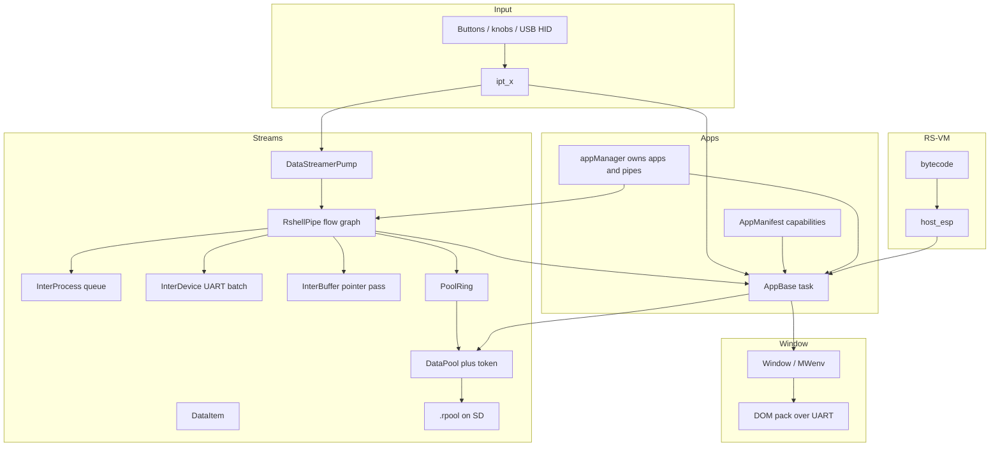

# OIRIA structure

Software isolation only. ESP32-S3 has no MMU sandbox. A pointer the app can
forge is not a capability. Capabilities are declared on the manifest and
checked at the call.

## Who owns what

| Object | Owner | Other holders |
| --- | --- | --- |
| AppBase | appManager shared_ptr | window, pipe targets (raw) |
| RshellPipe | appManager unique_ptr | pump vector (raw, locked) |
| DataItem on the pump queue | pump until dispatch, then dataitem_free | none |
| DataItem in an InterProcess queue | the pipe until pop or destructor | consumer after pop |
| DataPool | shared_ptr, usually the app | PoolRing, pipe target (raw) |
| Input event bytes | inside the DataItem payload | input_ev_ptr aims at that payload |

Fan / merge / c_fan / c_merge are the flow graph. They are not a property of
the queue. InterDevice is caller-driven (push / flush). The pump does not
walk it.

## Locks

- DataPool access_mutex: acquire / release / owner identity.
- DataPool ring mutex: push / pop / the .rpool snapshot.
- Pump pipe mutex: register, unregister, dispatch, drain. Recursive because
  on_stream_data may register a pipe. Do not destroy a pipe on the pump
  task. Destroy from another task so unregister waits until dispatch returns.
- Pump life mutex: start only. stop does not take it.

DataPool::system_writer() is the identity the pump passes when it writes a
ring an app owns. Same address space: an app can pass that pointer too.

## Still not done

- CBOR tags are not stored. dataitem_add_cbor_tag returns false.
- sink_register has no table. It returns false.
- Merge is "this item is already on the pump queue", not a multi-source join.
- ELF loader is not in the main component. IS_sandboxed is informational.
- sig_insn GPIO is the siggen program runner. The VM pin path is host_esp,
  which checks RAW_GPIO_ACCESS on the focused app. Boot and the LCD driver
  are system code and are not app-gated.
- Rings stay sized push / pop. No POSIX byte mode.
